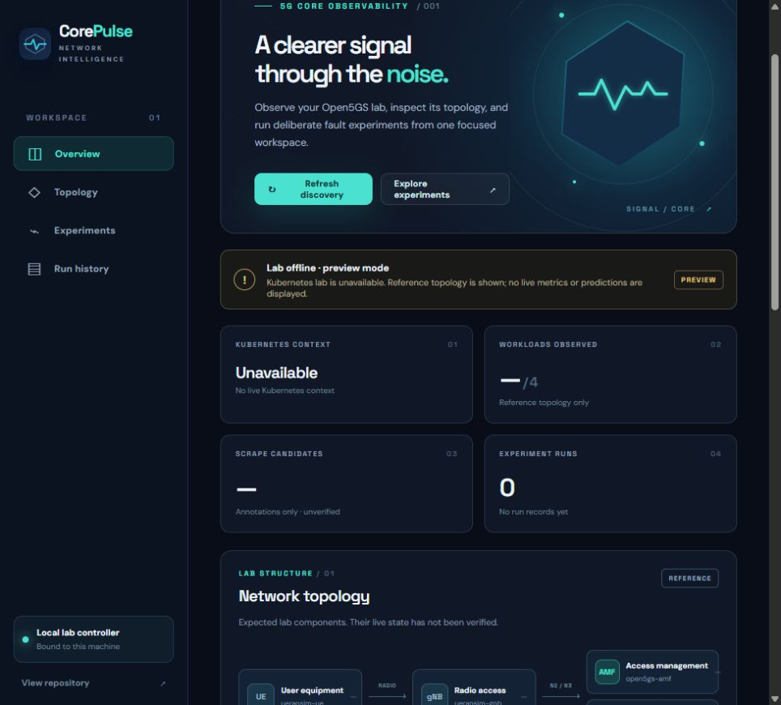
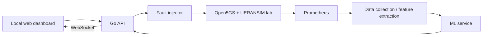
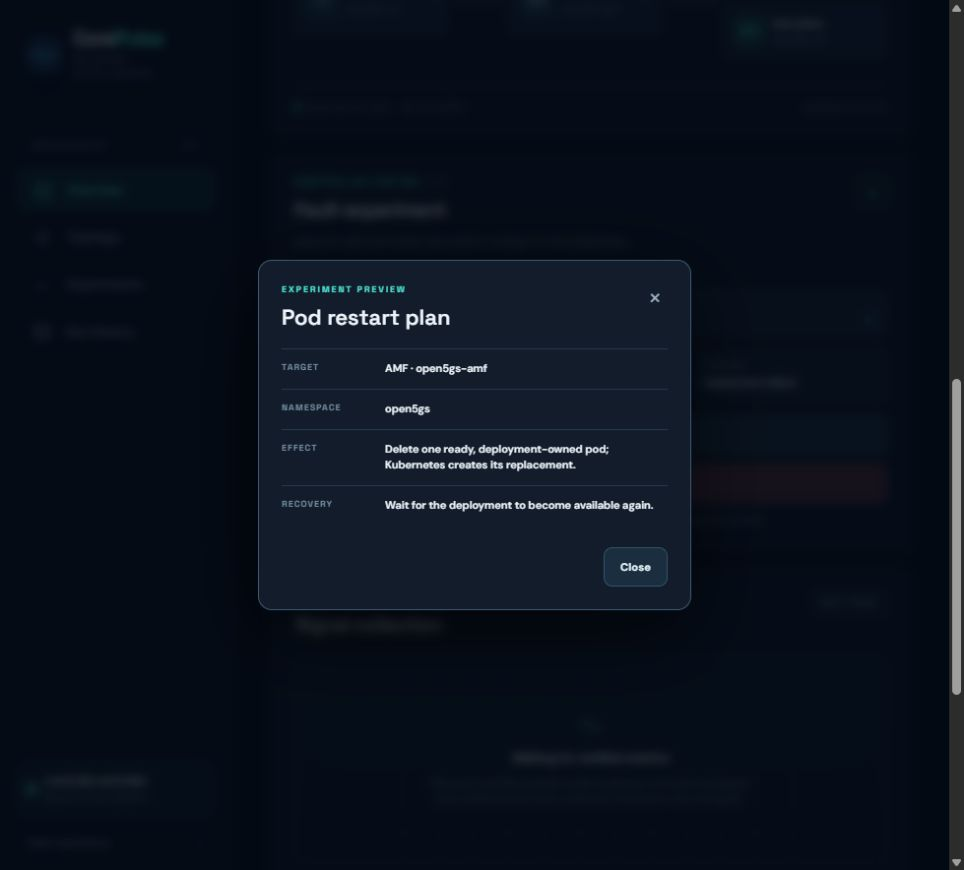
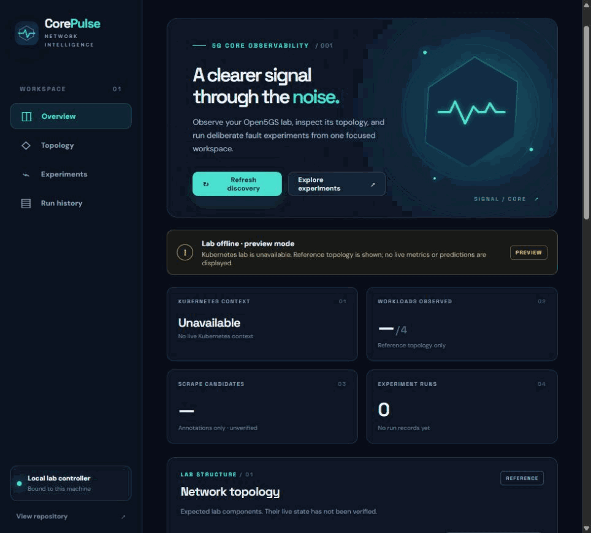
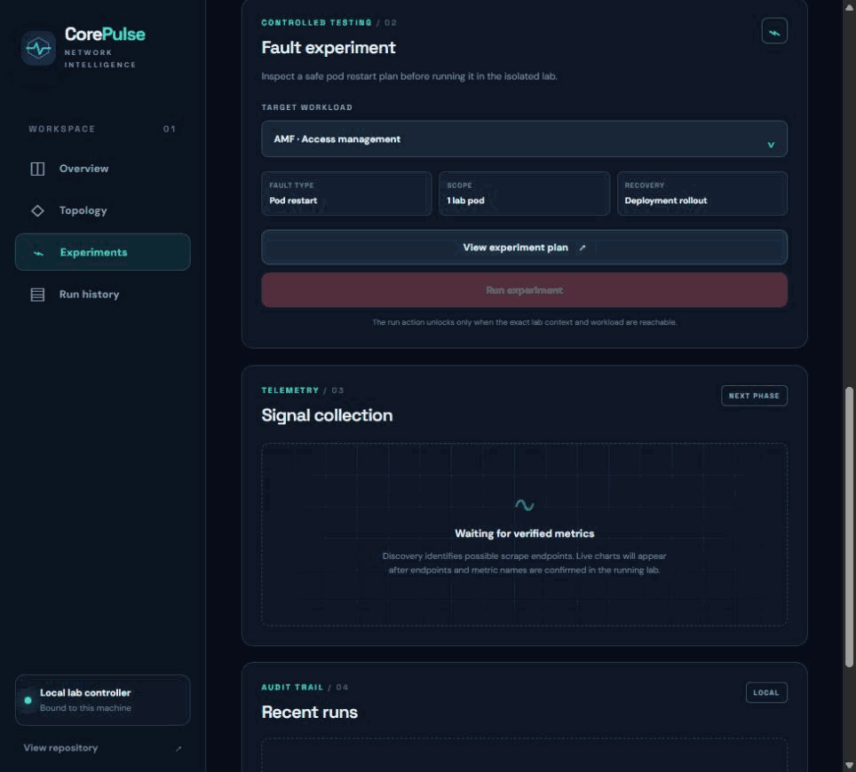

# CorePulse

<picture>
  <source media="(prefers-color-scheme: dark)" srcset="assets/corepulse-logo-dark.svg">
  
</picture>

> **Status:** Early development. The Go CLI and local dashboard implement read-only lab discovery and one guarded fault experiment. Live metrics, a trained model, and the full prediction dashboard are still future work.

CorePulse is an AIOps portfolio project for fault injection and intelligent detection in 5G core networks. It is being built to introduce controlled, reversible faults into an Open5GS + UERANSIM lab on Kubernetes, collect telemetry, train detection models, and display predictions in a live dashboard.

[](#interface-captures)

## Goal

In a 30-second demo, a user starts a fault, sees its effect on live metrics, compares the model prediction with the known fault label, and safely resets the lab. The target environment is a single Ubuntu machine with Minikube, Docker, and Helm.

## Proposed architecture



The existing [Open5GS + UERANSIM lab](https://github.com/lazypanic999/open5gs-ueransim-kubernetes) is the foundation. CorePulse is a separate project and does not change that lab's deployment files.

## What works today

- `corepulse discover` reads deployments, pods, services, and Prometheus scrape annotations from the `open5gs` namespace. It reports candidate endpoints without claiming metrics have been verified.
- `corepulse pod-crash --target amf|upf` prints a dry-run plan. With `--apply`, it validates the context and workload, deletes one deployment-owned pod, waits for its deletion and deployment recovery, and writes a run record.
- `corepulse serve` opens a local dashboard with lab connection state, workload topology, an experiment plan, and recent run records. The run control requires the exact lab context and a second typed confirmation. Offline preview mode does not invent live telemetry.
- Go unit tests and GitHub Actions CI cover discovery, fault safety guards, and the dashboard API.

The [lab integration notes](docs/lab-integration.md) distinguish repository-verified facts from checks that still require a running cluster. The [first design decision](docs/decisions/0001-start-with-discovery.md) explains why discovery comes before choosing model features.
The [Go decision](docs/decisions/0002-go-control-plane.md) records the control plane migration.
The current [run record schema](docs/run-record.md) documents the first fault label and recovery result.

## Try the first slice

Use Go 1.22 or newer, `kubectl`, and the isolated lab from the linked repository. Run the lab's own `scripts/verify.sh` before an experiment.

```bash
go run ./cmd/corepulse discover --output reports/discovery.json
go run ./cmd/corepulse pod-crash --target amf
```

The last command only prints a plan. To run the fault against the lab after reviewing that plan:

```bash
go run ./cmd/corepulse pod-crash --target amf --apply
```

The required Kubernetes context is `open5gs-lab`, matching the lab's Minikube profile. Run records are saved under ignored `runs/`. The command reports `recovery_unverified` and exits unsuccessfully if Kubernetes does not confirm recovery. This pod experiment is intended only for the local lab.

Run the tests without a cluster:

```bash
go test ./...
```

## Local dashboard preview

Start the Go server and open `http://127.0.0.1:8787`:

```bash
go run ./cmd/corepulse serve
```

The dashboard binds to loopback only. It shows a **preview** state when `kubectl` cannot reach the lab; reference topology is labeled as such, and the run button stays disabled. A connected lab enables read-only discovery. The pod experiment is available only for the `open5gs-lab` context with one ready replica of the selected deployment. The server repeats its safety checks before deleting a pod and saves the outcome under ignored `runs/`. Model predictions and live metric charts are intentionally absent until data sources are verified.

### Interface captures

These captures were taken from the running local Go dashboard on 31 October 2026. The Kubernetes lab was offline, so the UI correctly shows **preview mode**; no live metrics or model predictions are represented.




**Screen walkthroughs:**





- [Dashboard navigation video (MP4)](assets/dashboard-tour.mp4)
- [AMF/UPF experiment plan video (MP4)](assets/experiment-plan.mp4)
- [Full-page dashboard screenshot](assets/dashboard-overview.png)

## Initial scope

- **Fault injection:** `packet_loss`, `high_latency`, `sctp_drop`, `pod_crash`, plus an untouched `normal` condition. Each fault needs a recorded start time, end time, parameters, and rollback path.
- **Telemetry:** Prometheus collection for pod, network, and, if available, Open5GS metrics. Actual metric names must be verified during discovery.
- **Dataset:** CSV/Parquet time series with run IDs and labels; features extracted from 30-second windows.
- **Models:** Start with normal/anomalous detection, then fault type classification. Keep the control plane in Go; choose a model runtime after benchmarking. Split training and test data **by run**, never by individual window.
- **Dashboard:** Fault controls, live charts, known labels, and model predictions. Incorrect predictions must remain visible.

## Roadmap

| Phase | Deliverable | Acceptance criterion |
| --- | --- | --- |
| 0. Discovery | Lab inventory and metric list | Namespaces, services, pods, and scrape targets verified |
| 1. Injector | 3-4 reversible faults and run records | Faults can be started, stopped, and labeled |
| 2. Dataset | Automated collection and documented schema | Repeated runs with varied parameters are captured |
| 3. Models | Anomaly and classification baselines | Precision, recall, F1, and confusion matrix on held-out runs |
| 4. Dashboard | Controls, live charts, and prediction view | End-to-end demo works; local UI preview already exists |
| 5. Polish | One-command setup and demo recording | Reproducible on a clean machine |

## First tasks

1. Start the lab and run its end-to-end verification script.
2. Run CorePulse discovery against the live cluster, then probe candidate endpoints and record real metric names.
3. Define the `runs.json` and time-series dataset schemas from observed data.
4. Validate the pod fault in the lab and add packet loss and latency only after checking image privileges and rollback paths.
5. Build data collection, baseline models, and then the live dashboard.

## Design rules

- Run fault actions only in the lab namespace and from an explicit allowlist. Never execute user-supplied text as a command.
- Give every fault a rollback path and a basic test.
- Report model results honestly, including confused classes. Windows from the same run must never appear in both training and test sets.
- Keep tokens, passwords, large raw datasets, and trained model files out of Git by default.
- Verify metric names, ports, and setup commands against the working system before documenting them as facts.

## Open decisions

- Which Open5GS components expose useful metrics?
- Should the future live charts stay in the lightweight web UI, or should Grafana also be used?
- Which model runtime best fits the Go service after baseline evaluation?
- Should large datasets and model files be distributed through releases or separate storage?

The final setup flow, an end-to-end live demo, and measured model results will be added after a live lab run and end-to-end implementation.
