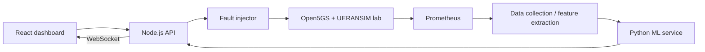

# 5G Fault Detector

> **Status:** Idea and discovery stage. This repository does not yet contain a working demo, trained model, or verified metric inventory.

An AIOps portfolio project that introduces controlled, reversible faults into an Open5GS + UERANSIM lab on Kubernetes, collects telemetry, trains fault detection models, and displays predictions in a live dashboard.

## Goal

In a 30-second demo, a user starts a fault, sees its effect on live metrics, compares the model prediction with the known fault label, and safely resets the lab. The target environment is a single Ubuntu machine with Minikube, Docker, and Helm.

## Proposed architecture

The existing `open5gs-ueransim-kubernetes` lab will be the foundation. New components should integrate without breaking its current setup.

## Initial scope

- **Fault injection:** `packet_loss`, `high_latency`, `sctp_drop`, `pod_crash`, plus an untouched `normal` condition. Each fault needs a recorded start time, end time, parameters, and rollback path.
- **Telemetry:** Prometheus collection for pod, network, and, if available, Open5GS metrics. Actual metric names must be verified during discovery.
- **Dataset:** CSV/Parquet time series with run IDs and labels; features extracted from 30-second windows.
- **Models:** Start with normal/anomalous detection, then fault type classification. Split training and test data **by run**, never by individual window.
- **Dashboard:** Fault controls, live charts, known labels, and model predictions. Incorrect predictions must remain visible.

## Roadmap

| Phase | Deliverable | Acceptance criterion |
| --- | --- | --- |
| 0. Discovery | Lab inventory and metric list | Namespaces, services, pods, and scrape targets verified |
| 1. Injector | 3-4 reversible faults and run records | Faults can be started, stopped, and labeled |
| 2. Dataset | Automated collection and documented schema | Repeated runs with varied parameters are captured |
| 3. Models | Anomaly and classification baselines | Precision, recall, F1, and confusion matrix on held-out runs |
| 4. Dashboard | Controls, live charts, and prediction view | End-to-end demo works |
| 5. Polish | One-command setup and demo recording | Reproducible on a clean machine |

## First tasks

1. Inspect the existing lab repository: namespaces, pods, services, setup, and verification scripts.
2. Identify metric endpoints and ports from the running lab; document only verified values.
3. Design an allowlisted injector restricted to the lab namespace.
4. Define the `runs.json` and time-series dataset schemas.
5. Implement the first fault with apply, verify, and rollback flows.

## Design rules

- Run fault actions only in the lab namespace and from an explicit allowlist. Never execute user-supplied text as a command.
- Give every fault a rollback path and a basic test.
- Report model results honestly, including confused classes. Windows from the same run must never appear in both training and test sets.
- Keep tokens, passwords, large raw datasets, and trained model files out of Git by default.
- Verify metric names, ports, and setup commands against the working system before documenting them as facts.

## Open decisions

- Which Open5GS components expose useful metrics?
- Should the charts be built entirely in React, or should Grafana also be used?
- Should large datasets and model files be distributed through releases or separate storage?

This README is an initial project draft. Verified setup instructions, a final architecture diagram, a demo GIF, and measured results will be added as the implementation progresses.
