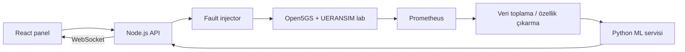

# 5G Arıza Dedektörü

> **Durum:** Fikir / keşif aşaması. Bu depo henüz çalışan bir demo, eğitilmiş model veya doğrulanmış metrik seti içermez.

Kubernetes üzerindeki Open5GS + UERANSIM laboratuvarında kontrollü ve geri alınabilir arızalar üretip telemetri toplayan, bu verilerle arıza tespiti yapan ve sonucu canlı bir panelde gösteren bir AIOps portföy projesi.

## Hedef

30 saniyelik bir demoda kullanıcı bir arızayı başlatır, metriklerdeki etkiyi görür, modelin tahmini ile gerçek arıza etiketi yan yana gösterilir ve arıza güvenle geri alınır. Hedef ortam tek bir Ubuntu makinesi üzerinde Minikube, Docker ve Helm'dir.

## Planlanan mimari

Mevcut `open5gs-ueransim-kubernetes` laboratuvarı temel alınacak; bu depoda geliştirilecek parçalar laboratuvarın mevcut kurulumunu bozmadan eklenecek.

## İlk sürüm kapsamı

- **Arıza üretimi:** `packet_loss`, `high_latency`, `sctp_drop`, `pod_crash` ve müdahalesiz `normal` koşulu. Her arıza başlangıç/bitiş zamanı ve parametreleriyle kaydedilecek; geri alma yolu olacak.
- **Telemetri:** Prometheus ile pod, ağ ve mümkünse Open5GS metrikleri. Gerçek metrik adları keşif aşamasında doğrulanacak.
- **Veri seti:** Run kimliği ve etiketiyle CSV/Parquet zaman serileri; 30 saniyelik pencerelerden özellik çıkarma.
- **Model:** Önce normal/anomali ayrımı, ardından arıza türü sınıflandırması. Eğitim ve test ayrımı **run bazında** yapılacak.
- **Panel:** Arıza kontrolleri, canlı grafikler, gerçek etiket ve model tahmini. Hatalı tahminler de görünür olacak.

## Yol haritası

| Aşama | Çıktı | Tamamlanma ölçütü |
| --- | --- | --- |
| 0. Keşif | Lab envanteri ve metrik listesi | Namespace, servis, pod ve scrape hedefleri doğrulandı |
| 1. Injector | Geri alınabilir 3–4 arıza ve run kaydı | Arızalar başlatılıp durdurulabiliyor; etiketler kaydediliyor |
| 2. Veri | Otomatik toplama ve belgelenmiş şema | Farklı parametrelerle yeterli sayıda run üretildi |
| 3. Model | Anomali ve sınıflandırma modelleri | Ayrı test run'larında precision, recall, F1 ve confusion matrix raporlandı |
| 4. Panel | Kontrol, grafik ve tahmin ekranı | Uçtan uca demo çalışıyor |
| 5. Cila | Tek komutlu kurulum ve demo kaydı | Temiz ortamda tekrar üretilebiliyor |

## İlk yapılacaklar

1. Mevcut lab deposunun namespace, pod, servis, kurulum ve doğrulama akışını incele.
2. Prometheus'a gerçekten açılan metrikleri ve portları ölçerek listele.
3. Arıza eylemleri için yalnızca lab namespace'ine ve izin listesine bağlı bir tasarım çıkar.
4. `runs.json` ve zaman serisi veri şemasını tanımla.
5. İlk arızayı uygulama, doğrulama ve geri alma akışıyla geliştir.

## Tasarım ilkeleri

- Arıza eylemleri yalnızca laboratuvar namespace'inde çalışır; kullanıcı metni doğrudan komuta dönüştürülmez.
- Her arızanın geri alma yolu ve temel testi bulunur.
- Model sonuçları başarısız sınıflar dahil dürüstçe paylaşılır; aynı run'ın pencereleri eğitim ve teste bölünmez.
- Token, parola, ham büyük veri seti ve eğitilmiş model dosyaları varsayılan olarak Git'e eklenmez.
- Metrik adları, portlar ve kurulum komutları çalışan sistemde doğrulanmadan belgelenmez.

## Henüz kararlaştırılacaklar

- Hangi Open5GS bileşenleri metrik sunuyor?
- Grafikler tamamen React ile mi çizilecek, Grafana da kullanılacak mı?
- Büyük veri setleri ve model dosyaları release veya ayrı depolamada mı tutulacak?

Bu README proje taslağıdır; uygulama ilerledikçe doğrulanmış kurulum adımları, mimari şeması, demo GIF'i ve ölçülmüş sonuçlar eklenecek.
