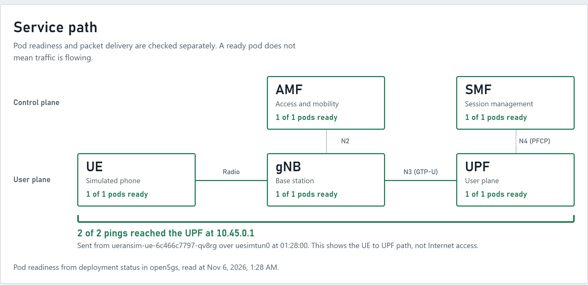
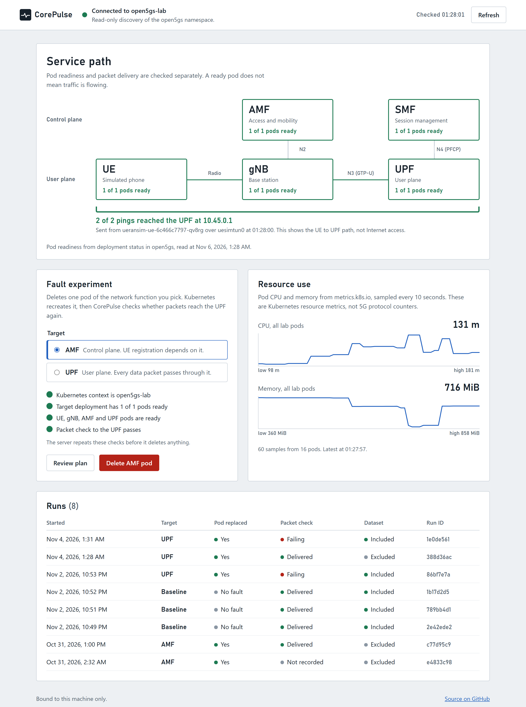

# CorePulse

[](https://github.com/lazypanic999/CorePulse/actions/workflows/ci.yml)
[](https://github.com/lazypanic999/CorePulse/actions/workflows/release.yml)
[](LICENSE)

<picture>
  <source media="(prefers-color-scheme: dark)" srcset="assets/corepulse-logo-dark.svg">
  
</picture>

CorePulse breaks a small 5G core on purpose and records what happens. It runs against an Open5GS and UERANSIM lab on Kubernetes, deletes one network function at a time under strict guards, and measures whether the service comes back, not just the pod. The long-term goal is a dataset and models that can tell which part of the core is failing.



> **Status:** early development. The CLI and dashboard work against the live lab today: discovery, a guarded pod-crash experiment, packet checks, resource metrics, and a curated dataset. Protocol-level telemetry, trained models, and predictions are not built yet.

## Why this exists

The first UPF experiment is the reason the project looks the way it does. I deleted the UPF pod and Kubernetes made a replacement ready, as it should. The UE still could not reach the UPF. SMF and UPF logs showed PFCP heartbeat and session failures, and restarting SMF and the UE did not reliably bring the data path back. It only recovered after SMF was pointed directly at the new UPF pod and the sessions were reset in order.

So CorePulse treats "the pod is back" and "packets flow again" as two separate results. Every run records both, and the dashboard draws them separately. The [validated signals](docs/validated-signals.md) and [lab integration notes](docs/lab-integration.md) have the details.

## What it does today

Discovery reads deployments, pods, services, and Prometheus scrape annotations from the `open5gs` namespace. It lists scrape candidates but does not claim a metric exists until someone checks it.

`pod-crash` deletes one AMF or UPF pod. Without `--apply` it only prints the plan. With `--apply` it first requires the exact `open5gs-lab` context, ready workloads, and a passing UE-to-UPF ping. It then watches the deployment recover and keeps probing the packet path. Two passing probes in a row count as service recovery, and every probe is saved in the [run record](docs/run-record.md).

`baseline` collects normal runs only while the packet check passes and the six essential pods (AMF, SMF, UDR, UPF, gNB, UE) stay ready and unchanged. `dataset` builds a CSV from clean runs only. Setup noise, interrupted runs, and unverified samples are counted and left out.

`verify-service` and `signals` check the current UE pod: the ping to the UPF gateway `10.45.0.1`, and registration and PDU session events in its recent logs. Log history and current packet health are reported separately.

The `internal/logevents` package parses registration, PDU session, and PFCP events from UERANSIM and Open5GS logs into timestamped events. It is tested against fixtures and is not wired into collection yet.

Checkpoints are written before a pod is deleted and throughout recovery, so an interrupted run still leaves evidence. `Ctrl+C` during a baseline stops cleanly and marks that run excluded.

## The dashboard

```bash
go run ./cmd/corepulse serve
```

Open `http://127.0.0.1:8787`. The server only binds to loopback and loads nothing from the internet.



This capture is from the live lab on 6 November 2026. The service path at the top shows each network function's pod readiness, with the latest packet check drawn as a separate bar under UE, gNB, and UPF. When pods are ready but pings fail, the bar turns red and dashed. The run history below has two UPF runs where exactly that happened: the pod was replaced, and packets still failed afterwards.

The delete button lists the four checks it needs and stays disabled until all of them pass. The server repeats them before it touches anything. CPU and memory come from `metrics.k8s.io`. They are Kubernetes resource metrics, not 5G protocol counters and not model predictions. When the lab is offline, the page says so and shows the expected layout as not observed instead of inventing data.

## Try it

You can build and test without a cluster:

```bash
go test ./...
go build -o corepulse ./cmd/corepulse
./corepulse pod-crash --target amf
./corepulse discover --snapshot examples/discovery-snapshot.json
```

The [contributor quickstart](CONTRIBUTING.md#quickstart-without-a-kubernetes-lab) covers the offline commands and the dashboard preview in more detail.

To run against a real lab you need Go 1.22 or newer, `kubectl`, and the [Open5GS + UERANSIM lab](https://github.com/lazypanic999/open5gs-ueransim-kubernetes) with a Kubernetes context named `open5gs-lab`. CorePulse is a separate project and never changes that lab's deployment files. On this Windows machine the lab runs in Ubuntu WSL:

```powershell
.\scripts\start-lab.ps1
```

After the lab is deployed, fix the gNB N3 address once, then run the lab's own `./scripts/verify.sh`:

```bash
bash scripts/configure-gnb-n3.sh
```

Then, from the same environment as the `open5gs-lab` context:

```bash
go run ./cmd/corepulse discover --output reports/discovery.json
go run ./cmd/corepulse verify-service
go run ./cmd/corepulse baseline --runs 3 --samples 4 --interval 10s
go run ./cmd/corepulse pod-crash --target upf --apply
go run ./cmd/corepulse dataset --telemetry data/telemetry.jsonl --runs-dir runs --output data/dataset.csv
```

After a UPF fault, `bash scripts/recover-service.sh` resets the UE, gNB, SMF, and UPF sessions and confirms the packet path again. The [lab operations guide](docs/lab-operations.md) explains it, along with subscriber setup and logs. Stop the lab with `.\scripts\stop-lab.ps1`.

Run records go to `runs/` and raw samples to `data/`. Both folders are ignored by Git. The ping check proves the UE reaches the UPF tunnel gateway. It does not prove Internet access.

## Downloads

[GitHub Releases](https://github.com/lazypanic999/CorePulse/releases) has preview binaries for Linux, macOS, and Windows with SHA-256 checksums. The container image `ghcr.io/lazypanic999/corepulse:v0.1.0` is on [GitHub Packages](https://github.com/lazypanic999/CorePulse/pkgs/container/corepulse) and includes `kubectl`. For a Minikube lab inside WSL, use the native binary in Ubuntu, because the cluster API is only reachable from there.

## Where it is going

The full plan with status per milestone is in [docs/ROADMAP.md](docs/ROADMAP.md). The phases:

| Phase | Deliverable | Done when |
| --- | --- | --- |
| 0. Discovery | Lab inventory and signal list | Workloads and signals verified against the live lab |
| 1. Injector | Pod crash, packet loss, latency, SCTP drop | Each fault can be started, rolled back, and labeled |
| 2. Dataset | Repeated clean runs with documented schema | Enough runs per fault, split by run |
| 3. Models | Anomaly and fault-type baselines | Precision, recall, F1, and confusion matrix on held-out runs |
| 4. Dashboard | Live predictions next to known labels | A full demo works end to end, wrong predictions included |
| 5. Polish | One-command setup and a demo recording | Works on a clean machine |

Discovery is done. The injector has one fault so far, the dataset has its first clean runs, and the dashboard has no prediction view yet because there is no model to show.

## Ground rules

Faults only run in the lab namespace, from a fixed allowlist, and never from user-supplied text. Every fault needs a rollback and a test. Model results will be reported with their confusions, and windows from one run never appear in both training and test data. Credentials, raw datasets, and model files stay out of Git. Metric names and setup steps are checked against the running system before they are written down as facts.

Design decisions are recorded in [docs/decisions](docs/decisions/), starting with [why discovery came first](docs/decisions/0001-start-with-discovery.md) and [why the control plane is Go](docs/decisions/0002-go-control-plane.md).

## Contributing

There are [good first issues](https://github.com/lazypanic999/CorePulse/labels/good%20first%20issue) and [help wanted tasks](https://github.com/lazypanic999/CorePulse/labels/help%20wanted), and several of them need no Kubernetes at all. Start with the [contribution guide](CONTRIBUTING.md). Please follow the [Code of Conduct](CODE_OF_CONDUCT.md), and report vulnerabilities privately as described in the [security policy](SECURITY.md).

Background reading, if you want the longer story:

- [Building CorePulse](https://dev.to/lazypanic999/building-corepulse-a-guarded-5g-core-fault-lab-in-go-4bpf) on DEV introduces the guarded experiment and its limits.
- [A ready 5G pod can still drop packets](https://dev.to/lazypanic999/a-ready-5g-pod-can-still-drop-packets-corepulse-needs-contributors-30f2) covers the UPF result and the first contributor tasks.
- The [r/devops thread](https://www.reddit.com/r/devops/comments/1xfq7qc/comment/19rzowqvsxmx0/) asks which signal best separates AMF from UPF trouble, and the [Open5GS discussion](https://github.com/open5gs/open5gs/discussions/4978) asks how SMF should re-associate when the UPF pod moves.

CorePulse is released under the [MIT License](LICENSE). See the [changelog](CHANGELOG.md) for what changed in each release.
