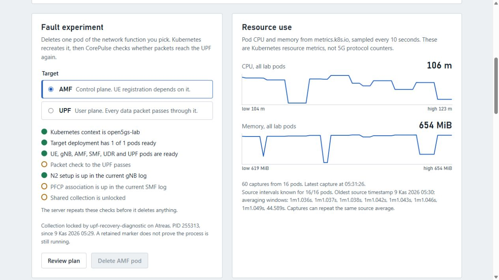

# Collection ownership (v0.2.1 preview and later)

One cooperating CorePulse CLI or dashboard process can own experiment collection for `open5gs-lab` / `open5gs` at a time. Baseline CLI batches acquire ownership before metric warmup and retain it through every run and the curated CSV export. Applied CLI/dashboard faults acquire it before preflight reads, request-triggered telemetry, deletion, recovery observation and dataset rebuilding. A contending caller refuses immediately; the dashboard returns HTTP 409 with the owner operation, host, PID, start time and marker path. A dry-run needs no ownership.

Ownership uses atomic directory creation and a random-token `owner.json`, with standard-library filesystem operations on Windows and Linux. It is independent of run/output directories. The default marker is `<user-cache>/CorePulse/locks/open5gs-lab-open5gs`, where the user cache is the platform's `os.UserCacheDir()`. Set **`COREPULSE_LOCK_DIR` to the same shared absolute directory in every cooperating process** if the lab is accessed across users, containers or Windows/WSL. A Windows path and its WSL mount path must point to the same underlying directory. Different default user caches do not coordinate across those boundaries. The v0.2.2 preview and updated source builds reject relative overrides because the same relative string can resolve to different markers in separate working trees; use absolute paths also with v0.2.1.

This is cooperative ownership, not a cluster-wide access-control system. Old release binaries, direct `kubectl`, separate marker locations and shell recovery helpers do not participate. Stop experiments before running `scripts/recover-service.sh` or other manual mutations. Internal collection functions are building blocks; production entry points must acquire ownership before using them. The v0.2.0 binaries predate this guard; use v0.2.1 or updated source builds.

Read-only pages and ordinary telemetry polling stay available. Background polling may still append raw samples; the marker serializes experiment intervals, not all resource reads or independent CSV/evaluation commands. Closing a browser tab does not terminate its server-side experiment. Ordinary errors and completed/cancelled baseline calls release matching ownership. Failure to release is reported rather than silently returning success.

## Forced termination and conservative recovery

A process killed without running its defers leaves the marker in place. A crash during marker creation can leave incomplete metadata; this also blocks collection. **There is no automatic expiry, PID-based stealing or force-unlock command.** PIDs can be reused and may belong to another host or process namespace.

1. Read the exact path in the refusal and inspect `owner.json` if present. Preserve the record alongside the interrupted run checkpoint.
2. Stop all CLI/dashboard experiment callers that share this lab, including other user/WSL/container sessions. Confirm that the recorded operation cannot still be running; an old timestamp or a missing PID in your current namespace is insufficient.
3. Inspect the interrupted run and actual pod/protocol/packet state. Checkpoints remain excluded until independently verified; removing a stale marker does not repair a run or restore service.
4. Only after confirming no active owner, move the exact stale marker directory aside to a named archive so its evidence remains inspectable. Do not remove a live marker or archive while another caller may still write to it. Restart cooperating callers with one common marker setting. Run any necessary lab reset before collecting another baseline/fault.

Normal release checks its token and refuses to remove symbolic-link ownership paths, changed ownership, malformed evidence or unexpected directory contents. It removes only its owner file and the now-empty directory. Manually changing/removing an active marker breaks the coordination guarantee.

The regression suite uses separate temporary markers and subprocesses: contention cannot enter the operation callback, normal completion releases, forced termination retains evidence, and changed/incomplete markers fail closed. CLI and HTTP tests verify refusal before cluster access and output creation. No Kubernetes cluster is needed.

## Dashboard ownership view (v0.2.2 and later)

The read-only `/api/collection` endpoint reports whether the configured marker can be inspected, whether it is locked, and an owner summary (operation, host, PID and start time). It never creates, expires or releases a marker and exposes neither the random release token nor the local marker path. An incomplete marker stays locked and requires inspection. A valid owner record is not proof that the process remains alive.

The dashboard polls this view every five seconds and disables both the run entry button and typed confirmation when ownership is held or cannot be checked. An in-flight submission also keeps confirmation disabled. These are advisory controls: another caller can acquire ownership between polls, so the server still atomically acquires the marker before any preflight or mutation. Read-only history and telemetry remain available.

