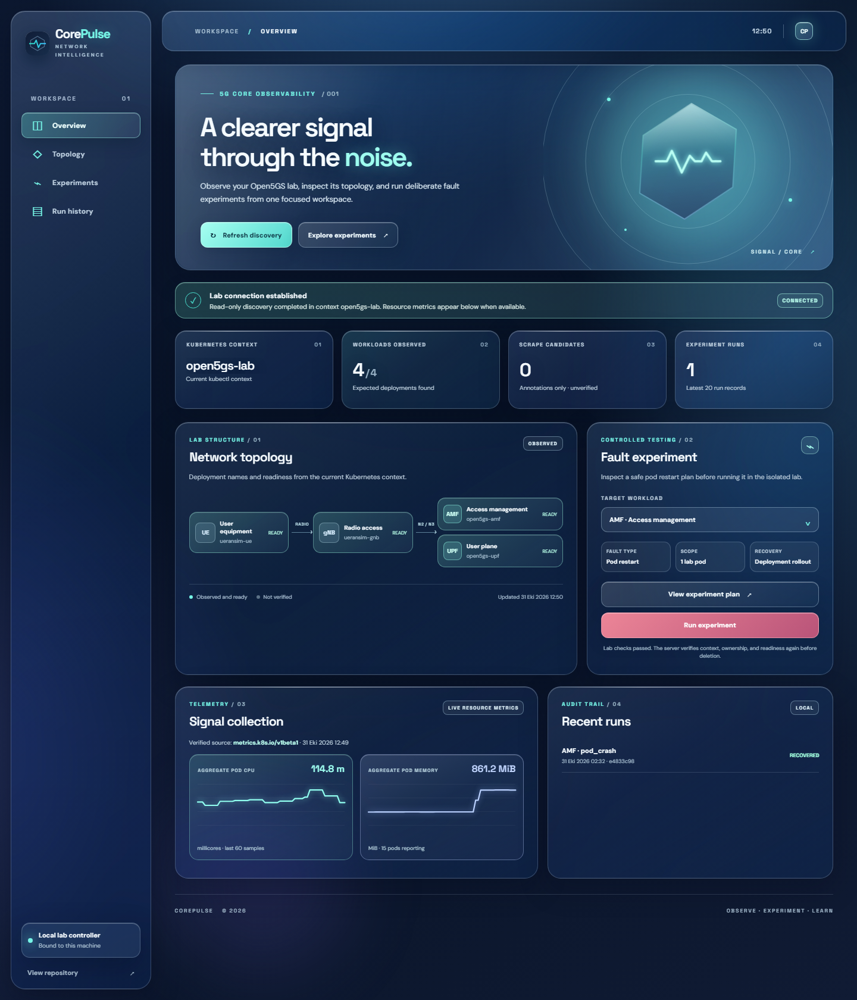

# Building CorePulse: a guarded 5G core fault lab in Go

I am building [CorePulse](https://github.com/lazypanic999/CorePulse), an open-source Go project for experimenting with failures in a local 5G core lab. It runs alongside Open5GS and UERANSIM on Kubernetes. The long-term goal is to collect labeled fault telemetry and evaluate detection models. The current version is deliberately earlier: a working control plane, one guarded fault type, live resource charts, and a service-path check.



## Why I started with a controlled experiment

It is easy to draw a fault-detection dashboard before there is a trustworthy fault label. I wanted the first usable slice to answer a simpler question: can I deliberately break one component, record when it happened, and tell whether Kubernetes and the UE path recovered?

CorePulse currently supports an AMF or UPF pod experiment in the isolated `open5gs-lab` context. The default command prints a plan. Applying the experiment checks the exact context, namespace, workload ownership, and readiness; deletes one deployment-owned pod; waits for deployment recovery; and writes a run record. The local dashboard repeats those checks and requires a typed target confirmation. It binds to loopback and disables the run control when the lab is unavailable.

```bash
go run ./cmd/corepulse pod-crash --target amf
go run ./cmd/corepulse pod-crash --target amf --apply
```

## What the dashboard actually measures

While the server runs, it samples Kubernetes pod CPU and memory every 10 seconds. `corepulse dataset` joins those samples with recorded experiment intervals to produce a labeled CSV. The dashboard also runs a read-only check from a ready UE pod to the UPF tunnel gateway. I keep that result separate from deployment readiness: a replacement pod becoming ready does not prove the UE data path works.

The first local lab verification passed UE registration, PDU session establishment, and external ping after correcting the UERANSIM gNB N3 address. That setup fix and its verification are documented in the repository. The gateway probe in CorePulse itself tests only UE-to-UPF forwarding; it does not claim to verify external reachability.

## What is still missing

There is **no trained detector or prediction in this preview**. The current chart is resource telemetry. The initial CSV includes lab startup and diagnostic activity, so I would not use it as a clean training set. Next I want repeated, isolated runs, more reversible fault types, and a model evaluation split by run rather than by individual sample window.

The [repository](https://github.com/lazypanic999/CorePulse) has the setup notes, tests, dashboard screenshots, and [v0.1.0 preview release](https://github.com/lazypanic999/CorePulse/releases/tag/v0.1.0). The current `main` branch also contains dashboard and gateway-probe changes made after that release.

If you have worked on telecom labs or chaos experiments, I would appreciate feedback on one design choice: which signal would you prioritize next for distinguishing AMF trouble from UPF trouble without mistaking Kubernetes pod readiness for end-to-end service health?

*Disclosure: This post was drafted with AI assistance. Technical claims were checked against the repository and lab notes.*

Published at: https://dev.to/lazypanic999/building-corepulse-a-guarded-5g-core-fault-lab-in-go-4bpf
