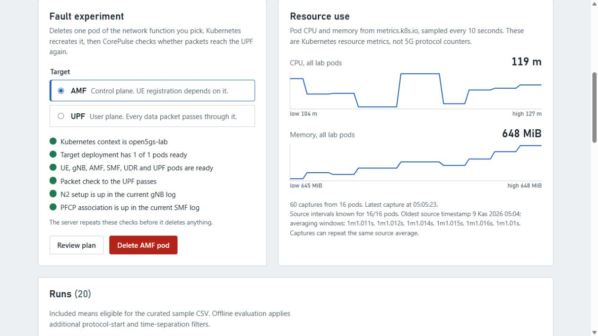

# Resource telemetry and first labeled dataset

The local Go dashboard samples the Kubernetes resource metrics API (`metrics.k8s.io/v1beta1`) every 10 seconds while `corepulse serve` is running. Samples are appended to ignored `data/telemetry.jsonl`. The collector accepts only the `open5gs-lab` context and the `open5gs` namespace. Failed reads are reported in the UI and do not create synthetic rows.

The verified fields in each raw sample are UTC `timestamp`, source, context, namespace, total CPU in millicores, total memory in bytes, reporting pod count, and each pod's CPU/memory usage. These are **Kubernetes pod resource metrics**, not Open5GS protocol KPIs or Prometheus scrape metrics. Scrape annotations remain unverified until their endpoints are probed independently.

`corepulse signals` exposes three read-only lab observations: registration and PDU-session success events in the current ready UE pod's recent logs, and a current UE-to-UPF gateway packet probe. The log booleans indicate that those transitions appeared in the pod log; they are not continuous success rates or proof of present session state. The gateway probe gives the current packet result. No PFCP, GTP-U, or AMF protocol counter has been verified as a live metric.

`protocol_events` in the same output lists timestamped events from the current UE, gNB, SMF, and UPF pods, read with `kubectl logs --timestamps --tail=300` and parsed by `internal/logevents`. Each component reports its pod, the time window its log covered, and how many lines were read. A component whose pod is not ready, or whose log cannot be read, reports an `error` and no events; that means not observed, not quiet. This output exposed a gap in the packet probe: after an AMF pod crash the probe passed while the gNB showed `n2_association_terminated` with no later `ng_setup_success`, so existing sessions worked but new registrations had no N2 path.

After a dashboard pod experiment, CorePulse writes the run JSON record and rebuilds ignored `data/dataset.csv`. It can also be rebuilt manually:

```bash
go run ./cmd/corepulse dataset --telemetry data/telemetry.jsonl --runs-dir runs --output data/dataset.csv
```

The CSV contains timestamp, `run_id`, label, target, provenance, pod count, aggregate CPU/memory, and AMF/UPF CPU/memory. It now includes only samples inside a run marked `quality: clean` with a matching verified status and lab provenance. Samples outside such intervals are excluded, **not** labeled normal. The summary reports `excluded`. Existing first-capture samples and old fault runs remain in the raw JSONL but do not enter this curated export. An experiment interval label still does not prove that every sample was degraded. Group future model train/test splits by `run_id`.

`corepulse baseline --runs 3 --samples 4 --interval 10s` writes three separate `normal` run records. Before collection it requires the exact lab context, one ready AMF, SMF, UDR, UPF, gNB, and UE pod, and a healthy UE-to-UPF gateway probe. It captures resource metrics and repeats the probe, pod identity, and metric coverage checks at every sample. A failed check leaves an `unverified` record with `quality: excluded` for diagnosis. The probe result is a gateway packet check, not a general Internet reachability guarantee.

Baseline interval waits and CLI kubectl calls are cancellable. `Ctrl+C` stops collection without starting another sample/run and saves the interrupted interval as excluded, with its end time and reason. Fault runs also save excluded checkpoints before deletion and during recovery; pending or interrupted intervals do not qualify for this CSV. Raw JSONL is preserved. See [run checkpoint and cancellation semantics](run-record.md#checkpoints-and-interrupted-processes).

New pod-crash runs require a healthy pre-fault probe and ready essential workloads, sample after each fault step, and record a post-recovery probe. They receive `quality: clean` if deployment recovery, at least one captured sample, and an observed post-run path outcome all succeed. The post-run path may be degraded: that is a valid outcome of a controlled fault, not a data-quality failure. Otherwise the run record remains useful for diagnosis but its samples are excluded from the curated CSV. This is an experiment-quality assertion; it does not claim every interval sample reflects degraded 5G service.

On 2 November 2026, the local lab produced three verified normal runs (four samples each) and one reviewed UPF fault run (three samples). The curated CSV contains 12 normal and 3 fault rows; 560 historical or unscoped raw rows were excluded. These local files are Git-ignored. Four runs are far too few for a trustworthy model evaluation, and the fault interval does not include the full period of degraded service after deployment readiness.

The metrics API may lag pod creation or deletion, and missing pods do not mean zero resource use. Samples remain raw and append-only; the CSV is reproducible from raw samples and run records. No model accuracy claim should be made from the first demonstration run.

## Capture time and source measurement time

`timestamp` at the sample root is the CorePulse capture time, not the time of a new CPU observation. New captures retain optional per-pod source metadata:

```json
{"name":"open5gs-amf-example","cpu_millicores":3,"memory_bytes":1048576,"measurement":{"timestamp":"2026-11-09T00:00:00.123Z","window":"1m0.008s"}}
```

The Metrics API reports a source `timestamp` and `window`; CPU is averaged over that interval. Different pods can have different intervals. CorePulse validates a nonzero RFC 3339 source timestamp and a positive Go duration, preserving both without substituting the capture time. If both API fields are absent, `measurement` is omitted and the source interval remains unknown. Partial or malformed live metadata fails that capture; invalid samples are not appended. Historical JSONL without `measurement` remains readable with no fabricated values. This additive field keeps raw `schema_version: 1` and existing resource values unchanged.

This metadata does **not** deduplicate samples, enforce freshness, change run labels, alter CSV columns, or become a fitted feature. A 30-second feature mean across captured CPU averages is not a new 30-second CPU measurement. Polling faster than the Metrics API updates can repeat the same source frame. A capture-time embargo alone cannot prove that underlying CPU intervals are disjoint. Source-time staleness, repeated-frame handling and train/test interval overlap need explicit follow-up policies. See the [Kubernetes resource metrics pipeline](https://kubernetes.io/docs/tasks/debug/debug-cluster/resource-metrics-pipeline/) and [window semantics](windowed-dataset.md).

The resource panel distinguishes capture times from source intervals, shows how many reporting pods carry known source metadata, and lists their averaging windows. Historical unknown intervals stay explicit. This is a provenance view, not a freshness cutoff or a new count of independent measurements.



## Missing component metrics in CSV

`amf_cpu_millicores`, `amf_memory_bytes`, `upf_cpu_millicores` and `upf_memory_bytes`
are nullable numeric fields. When a sample has no reporting pod for a component, both of its
fields are empty. A reporting pod with zero usage produces `0.000` for CPU and `0` for memory.
Usage is summed across reporting pod names with the component prefix, including replacement pods.
Presence refers to the metrics sample and can lag the actual pod lifecycle.

CSV consumers should parse an empty cell as missing. Consumers that require numeric values must
choose an explicit missing-data policy before training or aggregation. Older exports wrote zeros
for missing components, so rebuild them from the raw JSONL and run records to recover the
distinction. The export uses the existing column names and order and continues to group rows by
`run_id` within clean, provenance-checked run intervals.

## Packet and protocol evidence columns

Seven columns follow the resource columns. They come from the run record, not from the telemetry samples, and keep the same rule as the component metrics: an empty cell means not observed, `0` means observed and absent.

| Column | Value for each sample |
| --- | --- |
| `probe_status`, `probe_sent`, `probe_received` | The latest UE-to-UPF probe at or before the sample: baseline probes, the pre-fault probe, then the recovery probes. Empty before the first probe. |
| `smf_pfcp_failures` | SMF events since the run started: heartbeat timeout, no UPF available, de-association, and association retry failure. |
| `gnb_n2_terminations` | gNB `n2_association_terminated` events since the run started. |
| `ue_registrations`, `ue_pdu_sessions` | UE registration and PDU session successes since the run started. |

Runs written from 8 November 2026 store `protocol_events`, read once with `--timestamps --tail=300` after the run ends. A count is filled only when that component's log was read without error, its window starts at or before the run start, and it was read after the sample. Otherwise the cell is empty: a replacement pod's log, a truncated log, or a failed read cannot show what happened before it. Older runs have probes but no events, so only the probe columns are filled for them. Counts are cumulative within a run; differences between rows give per-interval counts.

## Timestamped protocol log events

`internal/logevents` parses UERANSIM UE and gNB logs and Open5GS SMF and UPF logs into structured events with a UTC timestamp, its source, the component, the event kind, a 1-based line number, and provenance (pod, container, log format).

| Kind | Component | Marker | Observed in this lab |
| --- | --- | --- | --- |
| `registration_success` | UE | `Registration is successful` | Yes |
| `registration_failure` | UE | `Registration failed` / `Registration reject` | Not yet |
| `pdu_session_success` | UE | `PDU Session establishment is successful` | Yes |
| `pdu_session_failure` | UE | `PDU Session Establishment ... reject/fail` | Not yet |
| `ng_setup_success` | gNB | `NG Setup procedure is successful` | Yes |
| `n2_association_terminated` | gNB | `Association terminated for AMF` | Yes, after an AMF pod crash |
| `pfcp_associated` | SMF, UPF | `PFCP associated` | Yes, both |
| `pfcp_heartbeat_timeout` | SMF, UPF | `No Heartbeat from UPF/SMF` | Yes (SMF), after a UPF pod crash |
| `pfcp_no_upf_available` | SMF | `No UPF available` | Yes, after a UPF pod crash |
| `pfcp_deassociated` | SMF, UPF | `PFCP de-associated` | Yes (SMF), after a UPF pod crash |
| `pfcp_association_retry_failed` | SMF, UPF | `Retry association with peer failed` | Yes (SMF), repeating every 11 s |

Each event carries `marker_observed_live`. The two failure markers still marked "not yet" follow upstream log text and must be confirmed against the pinned lab images before they are used as features. The fixtures in `internal/logevents/testdata/kubectl` are real lab output from 7 and 8 November 2026 with colour codes intact and subscriber identity lines removed; the other fixtures are synthetic.

Time handling is explicit. The preferred input is `kubectl logs --timestamps`: every line then starts with an RFC 3339 timestamp from the container runtime, which carries its zone and becomes the event time (`timestamp_source: runtime`). In that mode the application timestamp is only checked for shape. Without it, neither application format includes a zone, so the caller must pass the zone the container wrote in, and Open5GS timestamps also omit the year: the caller passes the collection time, and an event more than one day after it is assigned to the previous year. In the lab both formats are written in UTC and match the runtime timestamps to the millisecond.

ANSI colour escapes and CRLF endings are removed before parsing; Open5GS embeds colour codes inside the timestamp and component fields. Lines that start like a record but do not parse are reported in `skipped` with a reason and no message text, so subscriber identifiers are not copied. In runtime mode a line without the runtime prefix is skipped as `missing runtime timestamp`. Other lines, such as banners, are ignored.

Each matching line is one event, so repeated real events can be counted. `Dedupe` removes events that recur only because two log reads overlapped, using timestamp, component, kind, pod, and container.

The result has no health field. It reports `timestamped_lines` and the covered time `window`; a missing event means only that the marker did not appear in that window. It does not mean the service was healthy or that the failure rate was zero.
