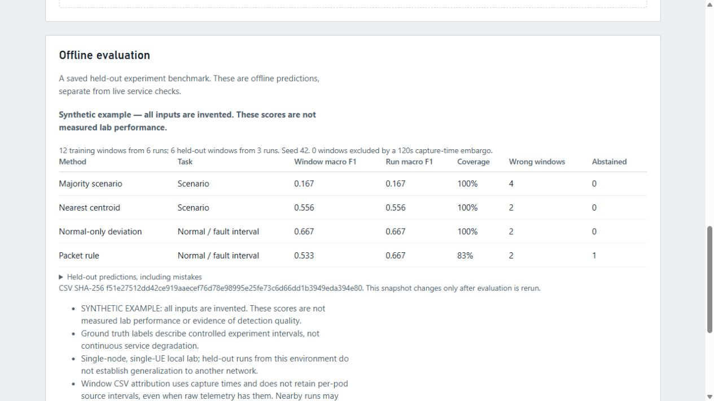

# Synthetic offline walkthrough

**Every value and identifier here is invented. These are schema fixtures, not measured 5G performance, a public lab dataset or proof of detection quality.** Each raw row and run record carries an `example_only` marker. The `verified`, `clean` and N2/N4 flags are fabricated example inputs; no actual protocol check occurred.

Use this walkthrough from the repository root with Go 1.22 or newer. The three offline commands do not require Kubernetes, Docker, Open5GS, Python or `kubectl`. The three pipeline outputs stay under ignored `reports/offline-example/`, separate from real telemetry, run records and the published local reference result.

```bash
go build -o corepulse ./cmd/corepulse
./corepulse windows --telemetry examples/offline/telemetry.jsonl --runs-dir examples/offline/run-records --output reports/offline-example/windows.csv --window 30s
./corepulse split --input reports/offline-example/windows.csv --output reports/offline-example/split.json --seed 42 --test-fraction 0.25 --embargo 2m
./corepulse evaluate --input reports/offline-example/windows.csv --split reports/offline-example/split.json --output reports/offline-example/evaluation.json --z-threshold 3 --synthetic
```

In Windows PowerShell, build with `go build -o corepulse.exe ./cmd/corepulse` and use `./corepulse.exe` for the remaining commands. Always pass **`--synthetic`** when evaluating invented examples. It marks the report and adds a prominent limitation; the flag is a declaration, not an automatic detector of synthetic input. Do not mix these fixtures with real run directories or use their scores in project performance claims.

## What to inspect

There are nine separately named toy intervals: three normal, three AMF and three UPF. Four captures per interval produce **18 windows**, with **12 training** and **6 held-out windows** at the fixed seed. Every run remains in one partition. Runs are spaced an invented hour apart, so the two-minute capture-time embargo purges none. Disjoint toy IDs and timestamps do not establish real measurement independence.

- Normal and AMF resource values are intentionally identical: resources alone cannot identify their difference. Wrong predictions remain in the report instead of making this a perfect-score demonstration.
- In each UPF interval, the first window has no reporting UPF pod and no earlier probe. Empty means unknown, not zero use or zero successful packets. The packet rule must abstain there.
- Normal/AMF captures contain a reporting UPF with **observed zero CPU**. Its numeric zero and missing ratio zero differ from the absent UPF's blank value and missing ratio one.
- Later UPF windows contain a fabricated failed packet probe. Fault labels describe whole controlled intervals, not an assertion that every instant is degraded.
- Per-pod `measurement` fields are invented one-minute source averages. A mean of captured averages does not become a fresh 30-second measurement. No physical network behavior is simulated by these numbers.

The JSON contains all four reference methods, full predictions, confusion matrices, per-class support/F1, coverage and abstentions. Scenario and binary tasks use different labels; do not rank their F1 as one task. The [methods](../../docs/offline-evaluation.md) and [real local dataset card](../../docs/datasets/2026-11-09-local-preview.md) explain the distinction.

To view this report in the dashboard:

```bash
./corepulse serve --addr 127.0.0.1:8790 --runs-dir reports/offline-example/no-real-runs --evaluation reports/offline-example/evaluation.json
```

Open `http://127.0.0.1:8790/#evaluation`. The evaluation section displays a **Synthetic example** warning. Other dashboard panels still attempt ordinary read-only observations of the actual allowlisted lab; without Kubernetes they show unavailable. They are not populated from these fixtures. If the lab is available, the standard collector still appends actual resource samples to ignored `data/telemetry.jsonl`; it never inserts this invented telemetry there. Close the server with Ctrl+C after viewing; this optional server does not replace the existing dashboard on port 8787.



## Fixture maintenance

Python is only needed to maintain/check the example. The standard-library generator writes deterministic UTF-8/LF files, and `--check` compares them without rewriting. The CLI checker uses temporary outputs and an empty executable search path, so it works without any cluster helper installed. CI runs the complete offline pipeline.

```bash
python3 examples/offline/generate.py --check
python3 scripts/check-offline-example.py --binary ./corepulse
```

Run the generator without `--check` only when intentionally changing these invented fixtures. It never reads the lab or real inputs. Keep the explicit synthetic markers, missing/zero distinction, mistakes and abstentions.
